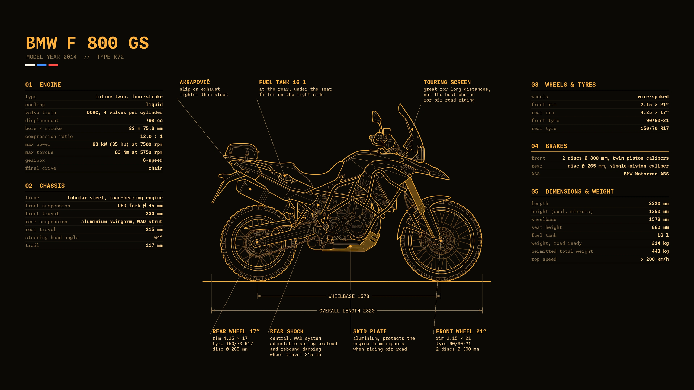

# F800GS-2014 Omarchy wallpaper

A technical spec-sheet wallpaper of a BMW F 800 GS (2014, type K72) for
[Omarchy](https://omarchy.org): a gold line drawing of the bike in side view,
dimension lines drawn at the drawing's own scale, and the factory data around
it. Shipped as a small Omarchy theme in the same warm gold, in English and
Polish.



## Install

```sh
omarchy theme install https://github.com/cielebak/F800GS-2014-omarchy-wallpaper
```

This adds the theme `f800gs-2014-omarchy-wallpaper` and switches to it. Step
between the English and the Polish sheet with `omarchy theme bg next`
(Super + Ctrl + Space).

To keep your current theme and only add the wallpaper, copy one file from
`backgrounds/` into `~/.config/omarchy/backgrounds/<your-theme>/`.

## Files

| File | |
|---|---|
| `backgrounds/F800GS-2014-en.jpg` | English sheet, 3840 x 2160 |
| `backgrounds/F800GS-2014-pl.jpg` | Polish sheet, 3840 x 2160 |
| `colors.toml` | gold-on-black palette the theme applies |
| `icons.theme` | Yaru-yellow icons |

## What is on the sheet

Engine, chassis, wheels and tyres, brakes, dimensions and weight from BMW's
data for the 2014 F 800 GS, plus callouts on the drawing: 21" front and 17"
rear wheels, the WAD rear shock, the skid plate, the fuel tank under the seat
with its filler on the right, an Akrapovič exhaust and a touring
screen. The last two are on this particular bike, not on a stock one. Figures
differ slightly between markets; check your own owner's manual before relying
on them.

The line drawing was generated with Google's Nano Banana from photos of the
author's own bike, then measured and laid out by hand.

## License

[CC BY 4.0](https://creativecommons.org/licenses/by/4.0/). BMW and F 800 GS
are trademarks of BMW AG; Akrapovič is a trademark of Akrapovič d.d. This is a
fan wallpaper, not affiliated with either.
